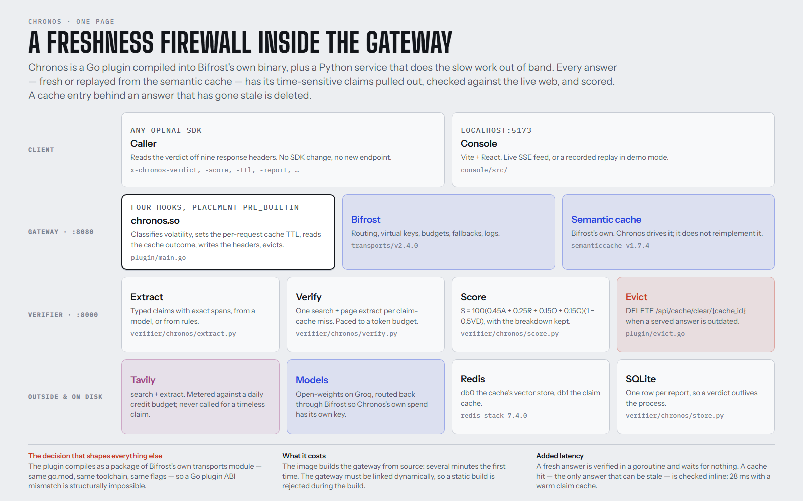
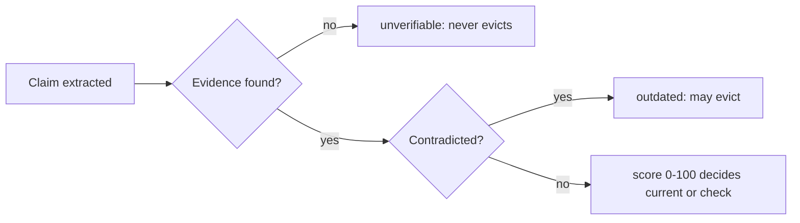
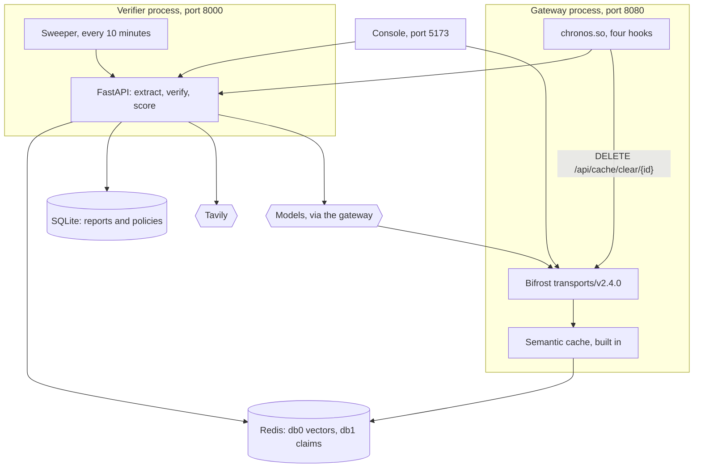
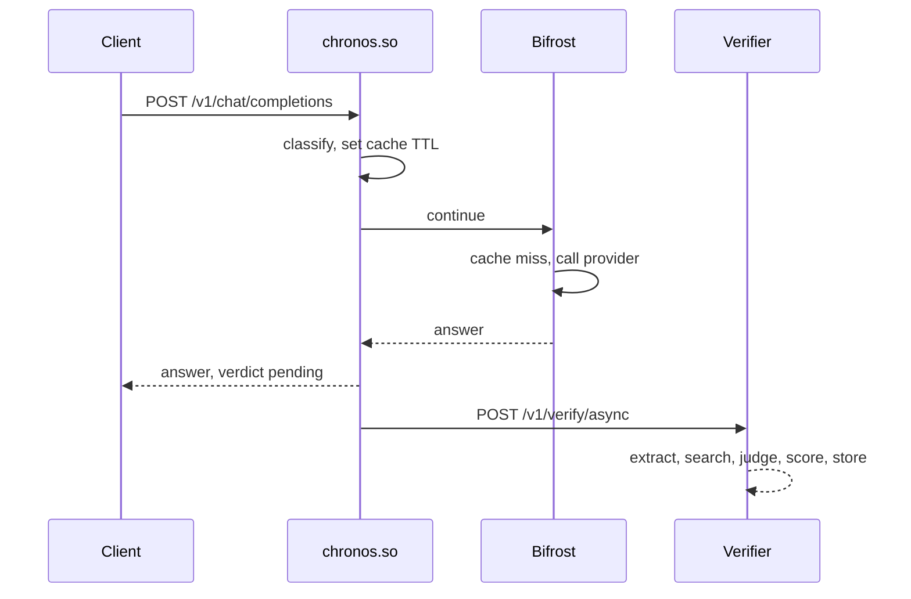
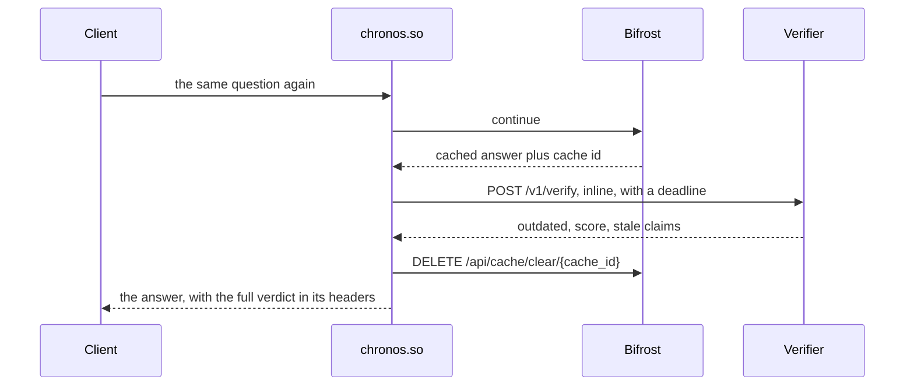
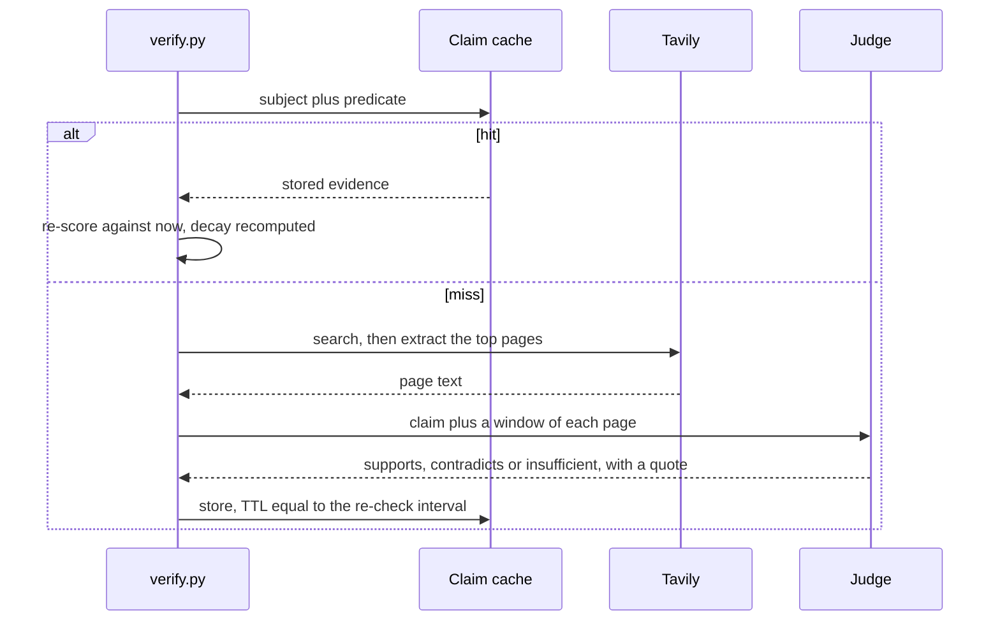
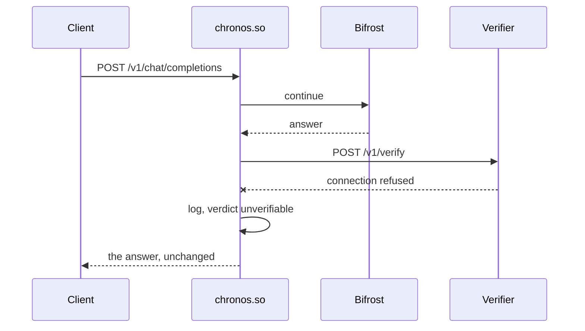
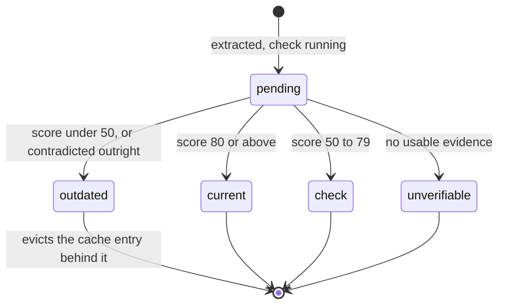

# Architecture

> The one-page version: [docs/architecture.png](docs/architecture.png), rendered from
> [docs/architecture.html](docs/architecture.html) — edit the HTML, never the PNG.
> Reference pages: [api](docs/api.md) · [environment](docs/environment.md) ·
> [deployment](docs/deployment.md) · [security](docs/security.md) · [ui](docs/ui.md) ·
> [troubleshooting](docs/troubleshooting.md). Results live in the
> [README](README.md#what-is-verified-and-what-is-not); this page has no numbers in it.



---

## 1. Core paradigm

Three ideas hold the design together. Each is a claim you could disagree with.

### 1.1 The cache hit is the risky request, so it is the one that waits

Everything else follows from this. A cache miss has already paid for a provider round trip
and returns an answer that is, by construction, as fresh as the model can make it. A cache
**hit** cost nothing and returns an answer written at some point in the past.

So the two are treated as opposites. A fresh answer is verified in a goroutine and waits for
nothing; its response carries `x-chronos-verdict: pending`. A cache hit is verified **inline**
within a deadline, because the thing being protected against is a hit, and because the budget
for waiting is exactly the provider latency the hit just saved.

The cost: a fresh answer's verdict arrives after the response, on the SSE stream and in the
report store. Anyone who needs the verdict in the response for every answer runs in `guard`
mode and pays for it.

### 1.2 Verification is a cacheable function of subject and predicate, not of the answer

Verifying a claim costs a search, a page extract and a judge call. The same claims recur
constantly: everyone asking what a model costs produces one claim about one subject and one
predicate. So the **verdict** is cached, keyed on the normalised subject plus predicate and
deliberately **not** on the stated value.

Not keying on the stated value is the subtle part. Two answers asserting different prices for
the same product are the same question — *what is this product's price?* — and must share one
verified answer. Including the stated value would mean a **wrong** answer never hits the
cache, which is exactly backwards.

A cached verdict is **re-scored, not replayed**: the evidence is reused, but the decay term is
recomputed against now. Replaying the stored score would reintroduce staleness one level up —
a stale staleness check.

### 1.3 Not knowing is a third answer



A claim Chronos could not check is a different thing from one it checked and found wrong, and
**only the latter may delete a cache entry**. Conflating them means a bad search day deletes
good cache entries, which is worse than the problem being solved.

The same asymmetry runs through the failure handling in section 6: every failure degrades
towards `unverifiable`, never towards `outdated`.

---

## 2. Topology

Five processes and two stores. The split is not microservice enthusiasm: the plugin must be
Go because it runs inside Bifrost's process, and the verifier must not be, because the
extraction, search and judging work is slow, I/O-bound and much easier to iterate on in
Python.



Two edges are worth noticing.

**`M --> B`.** The verifier's own model calls go back out through Bifrost rather than direct
to a provider. They inherit a virtual key with its own budget and rate limit, the gateway's
fallbacks, and the gateway's logs — so Chronos's own spend is visible next to the traffic it
is checking. Chronos dogfoods the gateway it extends. The cost is a loop: see section 3.1.

**`P --> B`.** Chronos never touches the vector store to evict. It asks the gateway, through
the same management API anyone else would use, so eviction stays correct if Bifrost changes
how the cache is stored.

---

## 3. Components

### 3.1 The plugin — `plugin/main.go`

Four hooks, registered with `placement: "pre_builtin"` and `order: 0`.

| Hook | What it does |
| :--- | :--- |
| `HTTPTransportPreHook` | Classifies the prompt's volatility with rules only — a few regex scans, no model call, no allocation worth measuring — and sets `x-bf-cache-ttl` from the result. Mints a correlation id. Skips the request entirely if it carries `x-chronos-internal` |
| `PreLLMHook` | Sets the semantic cache's TTL context value, a `time.Duration`, which is what the cache actually reads |
| `PostLLMHook` | Receives the answer **after** the cache has served it, reads the cache outcome from `schemas.CacheLookupFromContext`, and either spawns a verification or waits for one |
| `HTTPTransportResponseHeadersHook` | Writes the nine `x-chronos-*` headers just before headers commit, so streaming clients see the verdict too, and appends them to `Access-Control-Expose-Headers` without dropping the gateway's own entries |

**Post-hooks run in reverse order.** That is the whole reason for `pre_builtin` / `order: 0`:
it puts Chronos's `PostLLMHook` *after* the built-in cache's, which is the only arrangement in
which Chronos can see that an answer came from the cache.

It owns: volatility classification, the TTL decision, header assembly, eviction, and the
decision between inline and out-of-band. It deliberately does **not** own: anything that
needs the network for longer than a deadline, anything that needs a model, and the score.

Three behaviours here came from failures, not from documentation:

1. **Bifrost context values propagate downward only.** A verdict set in `PostLLMHook` is not
   visible to `HTTPTransportResponseHeadersHook`, so at first no headers appeared at all.
   Chronos mints a correlation id in `HTTPTransportPreHook` — a transport hook, so the value
   reaches both — and parks the verdict in `plugin/state.go`, a bounded store with a TTL.
2. **`ctx.Log` from a `.so` did not reach the gateway's log stream.** `stale_hit_prevented` is
   therefore also written to stderr, where it is observable.
3. **The management API needs `X-Bifrost-Setup-Token`** while dashboard auth is inactive, or
   eviction returns 403.

And one that is load-bearing: **`x-chronos-internal`**. The verifier sets it on every model
call; the plugin skips any request carrying it. Without it, Chronos verifies its own
verification calls, and each of those makes further calls that are verified in turn.
`plugin/internal_test.go` pins the string because it is hard-coded in two languages.

### 3.2 The verifier — `verifier/chronos/main.py`

Eighteen routes, no logic. The pipeline underneath is in
[docs/development.md](docs/development.md#layout), file by file. The shape:

`extract.py` turns an answer into typed claims with exact spans, by model or by rules.
`verify.py` orchestrates: claim cache, then Tavily search and page extract on a miss, then
the judge, then `score.py`. `llm.py` is the only place that calls a model and `tavily_client.py`
the only place that calls Tavily — each owns its own budget.

It owns: what counts as a claim, what the evidence says, and what the claim is worth. It does
not own: whether to evict (the plugin decides, because only the plugin knows a cache hit just
happened), or what the caller is allowed to do (`policies.py`, keyed on the virtual key
Bifrost already resolved).

### 3.3 Scoring — `verifier/chronos/score.py`

```
S = 100 * (0.45A + 0.25R + 0.15Q + 0.15C) * (1 - 0.5VD)
```

Pure functions over evidence, and the most-tested file in the repository. Every term is
reported in the response's `breakdown`, because a score nobody can argue with is not worth
having. The three decisions inside it that came from measured bugs are in the
[README](README.md#three-decisions-in-the-score-that-came-from-bugs).

### 3.4 The console — `console/src/`

A reader, not a participant. One page, seven sections, a live mode and a recorded demo mode.
[docs/ui.md](docs/ui.md).

---

## 4. Execution flows

### 4.1 A fresh answer — nothing waits



Notice that the response is already gone before the verifier is told anything. The client's
added latency is one goroutine spawn.

### 4.2 A cache hit — the one that matters



Notice what is **not** here: the stale answer is still returned to this caller. Chronos
annotates it and deletes the entry so the *next* caller gets a fresh one. Blocking is
`guard` mode's job, and it is off by default.

### 4.3 Verifying one claim



A timeless claim never reaches this diagram at all: it is skipped before the cache lookup and
costs nothing.

### 4.4 The failure path — the verifier is gone



**No hook returns an error that fails a request.** `scripts/verify-all.sh` asserts this by
stopping the verifier mid-run and requiring the gateway to keep answering.

---

## 5. State and persistence

| Store | Holds | Survives a restart? |
| :--- | :--- | :--- |
| Redis db0 | Bifrost's semantic cache and its vectors | Yes, in the `bifrost-data` volume |
| Redis db1 | Chronos's claim cache. TTL is the class's re-check interval | Yes |
| SQLite | Reports, policies, cache events | Yes, in the `verifier-data` volume, for `CHRONOS_REPORT_RETENTION_DAYS`. Pruned rows are folded into `pruned_totals` first, so lifetime counters survive |
| In-process, `plugin/state.go` | A verdict between `PostLLMHook` and the headers hook. 60 s, bounded at 4096 | No, and must not |
| In-process | The Tavily credit budget for the day | **No** — a known limitation |

A claim moves through four states, and only one of them may delete anything:



An answer's verdict is the **minimum** across its claims, and so is its TTL. One outdated
sentence makes the whole answer unsafe to act on, and averaging would hide it behind nine
timeless ones. The cost is that one stock price pulls an otherwise stable answer down to a
fifteen-minute TTL, which is the conservative direction and the right one.

The sweeper re-verifies stored reports every ten minutes, so an answer cached for six hours
is not trusted for six hours on the strength of one check.

---

## 6. Degradation, security and observability

Chronos has no failure mode that fails a request.

| Failure | Behaviour |
| :--- | :--- |
| Verifier down or slow | Response passes through, verdict `unverifiable`, warning logged |
| Tavily budget spent | Degrades to observe mode; `degraded` and `reason` are reported |
| Model unavailable | Falls back to rule-based extraction and judging, and says so in `extractor` |
| Redis unavailable | The claim cache falls back to a bounded in-process dict |
| Extraction returns nonsense | Retried once with the error attached, then `unverifiable` |
| Eviction returns an error | Logged; the answer is unaffected |
| Verification queue full | A background report is dropped rather than spawning goroutines without bound |
| A page tries to instruct the judge | The instruction is removed before the prompt, and the page is disqualified as evidence after judging: its call becomes `insufficient` |
| A claim's subject names nothing ("the CEO") | The claim is verified without the claim cache, so no other entity's verdict can be served for it |

What is protected, and the considerably longer list of what is not, is in
[docs/security.md](docs/security.md). The short version: keys never reach a log or a report,
Chronos's own spend has its own virtual key and budget, and eviction needs a token — and
nothing else is authenticated, including every route on the verifier.

Observability: `/v1/stats` and `/metrics` carry the same counters, `/v1/stream` carries one
SSE event per verification, and every verdict has a report id that appears in the response
headers. `CHRONOS_DEBUG=1` turns on the plugin's own log lines, which go to stderr as well as
to `ctx.Log` for the reason in section 3.1.

---

## 7. Where each part is proved

No results here; they are the [README's](README.md#what-is-verified-and-what-is-not).

| Subsystem | Command | What it covers |
| :--- | :--- | :--- |
| Config precedence, classification, headers, state, eviction, the loop guard | `go test ./...` in `plugin/` | The plugin's logic, without a gateway |
| The same, with the race detector | `go test -race ./...` in `plugin/` | The result store is written by one hook and read by another |
| Scoring, extraction, the rule judge, the claim cache, the pacer, page text | `pytest tests/` in `verifier/` | The verifier's pure logic, without a network |
| The plugin loads, caches, evicts, annotates, degrades | `./scripts/verify-all.sh` | The whole stack, end to end |
| Which models a key can actually reach | `./scripts/check-model.sh --all` | Answer, JSON mode, parseable JSON |
| Quality against hand-labelled claims | `python bench/runner.py` | Not pass/fail: a measurement |
| The console | `npm test` in `console/` | Its data layer, its state hook, what each section renders, and its fidelity to the design reference. Not what a browser paints: see [docs/ui.md](docs/ui.md#how-it-is-checked) |
