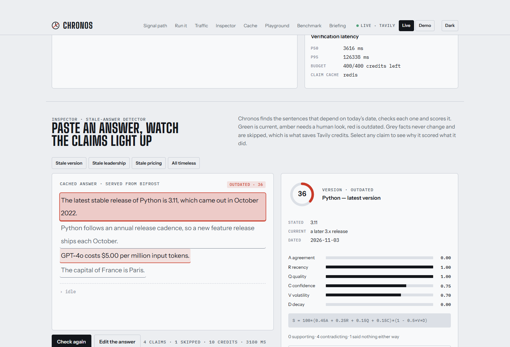
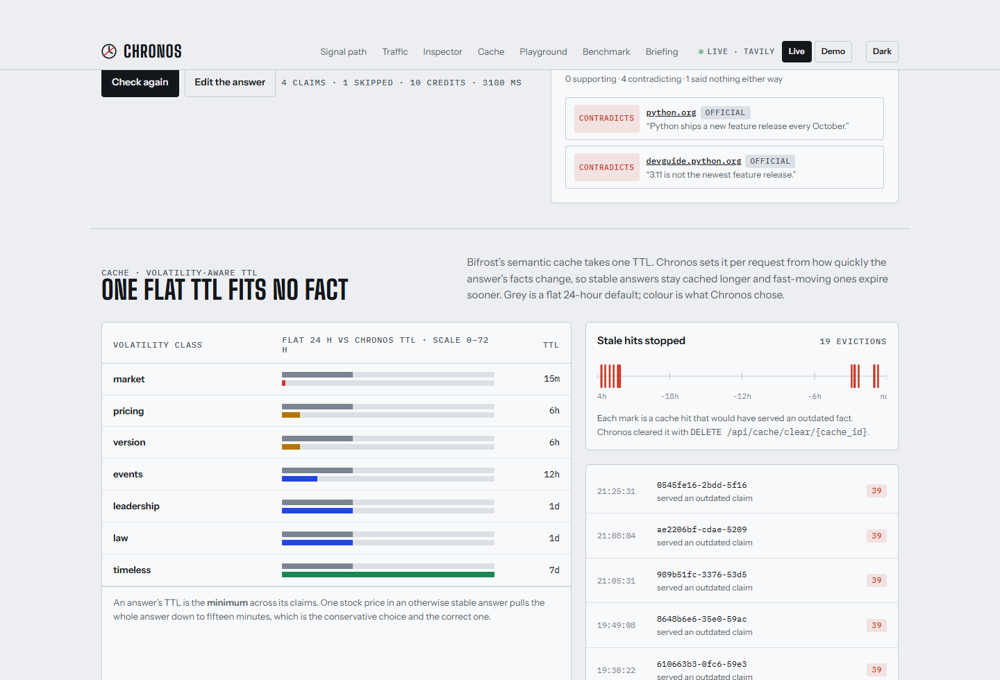

# Chronos


**A freshness firewall for the Bifrost AI gateway.**

*Semantic caching is the cheapest win in an LLM stack and the easiest way to serve a
confidently wrong answer.*

A cache keyed on what the user asked has no idea what the answer contained. It cannot tell
that the reply it stored holds a stock price, a model's per-token price, or the name of a
chief executive — facts with a shelf life measured in minutes, in weeks, and in "until
someone resigns". So it replays all three, identically, until a timer it picked without
looking at any of them runs out.

Chronos sits inside the gateway. For every answer, fresh or replayed, it pulls out the claims
that depend on today's date, checks them against the live web with Tavily, scores each 0–100,
reports the verdict in response headers, sets the cache TTL from how fast the answer's facts
actually move, and **deletes the cache entry behind any answer it finds has gone stale**.

It is not a fact checker. It has no opinion about anything without a date, it will not rewrite
an answer, and it is not a proxy in front of a gateway — it is a plugin compiled into one.

**Start here:** [see it work](TESTING.md) · [what is verified](#what-is-verified-and-what-is-not) ·
[how it works](ARCHITECTURE.md) · [all the docs](docs/README.md)

---

## Contents

[What it looks like](#what-it-looks-like) ·
[Run it](#run-it) ·
[Prove it](#prove-it-rather-than-read-about-it) ·
**[The signature mechanism](#a-cache-hit-is-the-only-answer-that-can-be-stale)** ·
[Architecture](#architecture) ·
[How Bifrost is used](#how-bifrost-is-used) ·
[How Tavily is used](#how-tavily-is-used) ·
[Scoring](#scoring) ·
[Volatility policy](#volatility-policy) ·
[Modes](#modes) ·
[Free models](#free-models-and-living-inside-a-free-tier) ·
**[Measured results](#measured-results)** ·
**[What is verified, and what is not](#what-is-verified-and-what-is-not)** ·
[Design decisions](#design-decisions-worth-explaining) ·
[Layout](#repository-layout) ·
[Documentation](#documentation)

---

## What it looks like

| | |
|---|---|
|  |  |
| **The inspector.** The claims found inside one cached answer, each scored, with every term of the formula and the pages that disagreed, quoted. This is the product. | **The cache ledger.** What Chronos chose for each volatility class against a flat default, and the real evictions underneath, with the cache ids it deleted. |

Both are captures of the running console, regenerated by a script whose shot list is in the
repository at `docs/screenshots/shots.json`. More of them, and the design they are built to:
[docs/ui.md](docs/ui.md).

You can open the console itself without installing anything. It works with **no backend**:
when the verifier is unreachable it replays a recorded log and labels itself *"Recorded demo
replay"* on the page. It opens on a full screen of argument and offers a **guided
walkthrough** — eight steps that scroll the real page and ring the panel being discussed.

```bash
./scripts/build-demo-site.sh          # needs Node; writes console/dist-demo
npx http-server console/dist-demo -p 8099
```

That folder is plain static files with relative paths, so it can be hosted anywhere.

### The cycle, as it actually ran

One version question asked three times through the gateway:

| # | Bifrost cache | Chronos verdict | What happened |
|---|---|---|---|
| 1 | miss | `pending`, class `version`, `x-chronos-ttl: 21600` | verified out of band — the answer waited for nothing |
| 2 | **hit** | `outdated`, score **39**, 1 stale claim | caught inline, and the entry **evicted** |
| 3 | **miss again** | `pending` | the stale answer is gone; the next caller gets a fresh one |

The real headers from request 2:

```
x-bifrost-cache-hit: true
x-bifrost-cache-id: 610663b3-0fc6-59e3-9486-4cfe2375aa3e
x-chronos-verdict: outdated
x-chronos-score: 39
x-chronos-claims: 1
x-chronos-stale: 1
x-chronos-class: version
x-chronos-ttl: 21600
x-chronos-report: http://verifier:8000/v1/reports/c42b3a05790b489c
x-chronos-latency-ms: 1524
```

and the gateway's own log line, from inside the plugin. This one is from an earlier run of
the same cycle, which is why the score and the ids differ:

```
stale_hit_prevented cache_id=b0a16f57-9e39-5040-b087-56a8be8744f1
  cache_key=verify-1793982948 score=36 stale_claims=1 report=657e6eeb813c4388
```

---

## Run it

> Evaluating this rather than building on it? [TESTING.md](TESTING.md) is written for you.
> Level 1 needs nothing installed.

Needs **Docker**. Nothing else, and no API keys: the stack ships a mock provider and recorded
evidence so that `docker compose up` works with no credentials at all.

```bash
git clone <this repo> chronos && cd chronos
cp .env.example deploy/.env     # optional; every variable has a working default
cd deploy && docker compose up --build
```

The first build takes several minutes: it downloads Bifrost's source and compiles the gateway
*and* the plugin together, for the reason in [docs/deployment.md](docs/deployment.md#why-the-image-is-built-this-way).

Then:

```bash
curl -i http://localhost:8080/v1/chat/completions \
  -H 'Content-Type: application/json' \
  -H 'x-bf-cache-key: demo' \
  -d '{"model":"mockllm/chronos-demo",
       "messages":[{"role":"user","content":"What is the latest version of Python?"}]}'
```

| | URL |
|---|---|
| Bifrost gateway, OpenAI-compatible | <http://localhost:8080/v1/chat/completions> |
| Chronos verifier | <http://localhost:8000/health> |
| Console | <http://localhost:5173> |
| Prometheus metrics | <http://localhost:8000/metrics> |

**With no keys**, answers come from `deploy/mockllm` and evidence from
`verifier/fixtures/evidence.json`. The scores are computed by the real scoring code and the
evidence is synthetic — and `mockllm` also answers Chronos's *own* extraction and judge
prompts with strict JSON, so the whole model path is exercised with no key at all. Only the
quality of the judgement needs a real model.

Two free keys, neither needing a card, switch on the real paths:

| Variable | Effect |
|---|---|
| `TAVILY_API_KEY` | Evidence comes from the live web |
| `GROQ_API_KEY` plus `CHRONOS_LIVE_MODELS=1` | Model-based extraction and judging: the designed path |
| neither | Rule-based extraction and judging over recorded evidence |

Everyday commands:

| | |
|---|---|
| `./scripts/verify-all.sh` | every check, end to end |
| `./scripts/build-demo-site.sh` | the console as a static folder that needs no backend |
| `./scripts/verify-all.sh --unit` | the test suites only, no Docker stack |
| `./scripts/check-model.sh --all` | which models your key can actually reach today |
| `python bench/runner.py --limit 18 --audit` | the quality benchmark |

All 44 environment variables: [docs/environment.md](docs/environment.md).

---

## Prove it rather than read about it

```bash
./scripts/verify-all.sh
```

Real output, trimmed to the end:

```
== console ==
  PASS console: typecheck, app and tests
  PASS console: unit and rendering tests

== stack ==
  PASS plugin .so is in the image and dynamically linked
  PASS gateway loaded chronos.so
  PASS P1: second identical request is a cache hit
  PASS P4: Chronos set a 6h cache TTL for a version claim
  PASS P4: the cached stale answer was caught (verdict=outdated, score=39)
  PASS P4: the stale entry was evicted, so the next request is fresh
  PASS verifier: a timeless answer spends no Tavily credit
  PASS console: x-chronos-* headers are CORS-exposed
  PASS model path: fallbacks are accepted in Bifrost's wire format
  testing the degrade path (verifier stopped)
  PASS degrade path: the gateway still answers with the verifier down

== summary ==
  44 passed, 0 failed, 0 skipped
```

Each check prints what it asserted, so a pass means something specific rather than the absence
of errors. Start with this one; it is the same script CI runs.

---

## A cache hit is the only answer that can be stale

This is the part that makes Chronos different from putting a fact checker in front of a
gateway, and the whole design falls out of it.

A cache **miss** has already paid for a provider round trip, and returns an answer as fresh as
the model can make it. A cache **hit** cost nothing and returns an answer written at some
point in the past. They are opposites, so they are treated as opposites.

**On a miss**, `plugin/main.go`'s `HTTPTransportPreHook` classifies the prompt's volatility —
rules only, a few regex scans, no model call — and sets `x-bf-cache-ttl` from the result, so
the answer that is about to be stored is stored for a sensible time rather than a default day.
The answer goes out immediately with `x-chronos-verdict: pending`, and verification happens in
a goroutine. The client's added latency is one spawn.

**On a hit**, `PostLLMHook` sees the cached answer *and* the cache outcome, and verifies
inline within a deadline. The budget for waiting is exactly the provider latency the hit just
saved. With a warm claim cache that measured **28 ms**. If a claim comes back `outdated`,
`plugin/evict.go` calls `DELETE /api/cache/clear/{cache_id}` on the gateway's own management
API — Chronos never touches the vector store directly — and the next caller gets a fresh
answer.

Seeing the hit at all depends on one line of configuration. Bifrost runs post-hooks in
**reverse** order, so `placement: "pre_builtin"` with `order: 0` is the only arrangement in
which Chronos's `PostLLMHook` runs *after* the built-in semantic cache's. Move it and every
test still passes while the product quietly stops working.

Three things about Bifrost that are not in its documentation, all found the hard way, all now
in the code comments and in
[ARCHITECTURE.md](ARCHITECTURE.md#31-the-plugin--pluginmaingo): **context values propagate
downward only**, so a verdict set in `PostLLMHook` is invisible to the headers hook — hence
the correlation id and `plugin/state.go`; **`ctx.Log` from a `.so` never reached the
gateway's log stream**, so `stale_hit_prevented` goes to stderr as well; and **the management
API needs `X-Bifrost-Setup-Token`** or eviction returns 403.

And one that is Chronos's own fault. Its extraction and judging calls go back out *through*
Bifrost, where the plugin is attached — so without a marker, Chronos verifies its own
verification calls, and each of those makes further calls that are verified in turn. The
verifier now sets `x-chronos-internal` on every model call and the plugin skips any request
carrying it. Measured before the fix: **4,605 verifications and 37 minutes of rate-limit
waiting from a single 18-claim benchmark run.** `plugin/internal_test.go` pins the string,
because it is hard-coded in two languages and nothing fails loudly when they drift.

---

## Architecture

```
request ─▶ Bifrost ─▶ semantic cache ─▶ provider
              │            │
              │            └── hit? the answer may be months old
              ▼
           Chronos  ─▶ claims ─▶ Tavily ─▶ score ─▶ x-chronos-* headers
                                                 └─▶ DELETE /api/cache/clear/{id}
```

Five processes: the gateway on `:8080` with `chronos.so` inside it, the verifier on `:8000`,
the console on `:5173`, Redis holding both the cache's vectors and Chronos's claim cache, and
a mock provider on `:8900` so the whole thing runs keyless.

**The decision that shapes everything else: the plugin is compiled as a package of Bifrost's
own `transports` module** — same `go.mod`, same `go.sum`, same toolchain, same flags, same
libc. Go's plugin loader rejects any `.so` whose build differs from the host binary's, and it
does so at runtime, after a clean start. The alternative was maintaining two module graphs and
hoping they resolve identically; this way an ABI mismatch is structurally impossible. It costs
an image that builds the gateway from source, several minutes the first time. The gateway is
also built **without** static linking, because a static binary can load no plugin at all — and
the build fails loudly if it ever produces one.

Built and verified against:

```
bifrost_ref   transports/v2.4.0
go            1.27.3
core          v1.14.1
framework     v1.11.1
semanticcache v1.7.4
```

Full topology, the four execution flows, where state lives and what survives a restart:
[ARCHITECTURE.md](ARCHITECTURE.md). The build, in detail:
[docs/deployment.md](docs/deployment.md).

---

## How Bifrost is used

Chronos is a **Bifrost plugin**, not a proxy in front of one, and it would not work as
anything else.

| Bifrost feature | What Chronos does with it |
|---|---|
| `HTTPTransportPreHook` | Classifies the prompt's volatility with rules only, and sets `x-bf-cache-ttl` from the result |
| `PreLLMHook` | Sets the semantic cache's TTL context value, a `time.Duration`, which is what the cache actually reads |
| `PostLLMHook` | Receives the answer *after* the cache has served it, so cached answers are checked too. Reads the outcome from `schemas.CacheLookupFromContext` |
| `HTTPTransportResponseHeadersHook` | Writes the `x-chronos-*` headers just before headers commit, so **streaming** clients see the verdict too |
| Plugin placement | `pre_builtin`, `order: 0`. Post-hooks run in reverse, which is the only way to see a cache hit |
| Semantic cache | Chronos drives it rather than reimplementing it: per-request TTL in, `cache_debug` out |
| `DELETE /api/cache/clear/{cache_id}` | The eviction mechanism. Chronos never touches the vector store |
| Virtual keys | The verifier authenticates with its own key, so Chronos's model spend has its own budget and rate limit |
| Fallbacks | Its model calls carry a `fallbacks` chain, so a 429 becomes a fallback call rather than an unverifiable answer |
| Custom providers | `deploy/mockllm` is registered as one (`base_provider_type: openai`) for the keyless demo |

**Chronos dogfoods the gateway**: every model call it makes goes back out through Bifrost
rather than direct to a provider.

## How Tavily is used

| Tavily feature | What Chronos does with it |
|---|---|
| `search` | One advanced search per claim-cache miss, with `topic: news` for fast-moving classes |
| `extract` | Full page text for the top three results, so the judge reads pages rather than search snippets |
| Credit budget | Every call is metered. When the day's allowance is spent the verifier degrades to observe mode and says so in `degraded`/`reason` — it never silently overspends or fails a request |
| Claim cache | A Tavily call only happens on a claim-cache miss. Timeless claims never reach Tavily at all |

Two details worth the space. The judge reads a **window** of each page, not the whole thing,
and that window centres on the claim's **predicate** rather than its stated value. Centring on
the stated value seems obvious and is backwards for exactly the claims that matter: judging
"Larry Page is the CEO of Google" against Google's own newsroom, "Larry Page" does not appear
— the page says someone else — so the search missed, the window fell back to the top of the
page, and the judge called a page that answered the question outright "insufficient".

And `include_domains` is **not** used, though an earlier version did restrict searches to
official domains for recognised subjects. It is a hard filter, not a preference, and it turned
a correct `outdated` into an `unverifiable`.

---

## Scoring

Each claim gets a score and a full breakdown, so no number is unexplained:

```
S = 100 * (0.45·A + 0.25·R + 0.15·Q + 0.15·C) * (1 − 0.5·V·D)
```

| Term | Meaning |
|---|---|
| **A** | agreement: net supporting share **of the sources that addressed the claim** |
| **R** | recency: 1.0 under 7 days, falling linearly to 0 at 365 |
| **Q** | source quality: official 1.0, major news 0.7, other 0.4 |
| **C** | the judge's confidence |
| **V** | volatility weight: market 1.0 … timeless 0.0 |
| **D** | time since last check ÷ the class's re-check interval, capped at 1 |

Verdicts: **80+** `current`, **50–79** `check`, **below 50** `outdated`. No usable evidence is
`unverifiable` — never `outdated`.

### Three decisions in the score that came from bugs

1. **A divides by the sources that addressed the claim**, not by everything the search
   returned. Dividing by all five gave one confirming source plus four irrelevant ones an A of
   0.2 and a score of 44.5 — `outdated` for a claim that had just been confirmed and never
   disputed.
2. **The verdict accounts for direction, not just magnitude.** With A floored at 0, R, Q and C
   alone cap a flatly refuted claim at 55, inside the `check` band. A claim refuted by two
   official same-week sources is strong evidence of *wrongness*, so a contradicted claim is
   `outdated` whatever S says.
3. **Absent evidence is `unverifiable`.** A claim Chronos could not check is a different thing
   from one it checked and found wrong, and only the latter may evict a cache entry.
   Conflating them deletes good cache entries on a bad search day.

## Volatility policy

| Class | Re-check interval | Max answer TTL |
|---|---|---|
| market | 1 h | 15 min |
| pricing | 3 d | 6 h |
| version | 3 d | 6 h |
| leadership | 14 d | 24 h |
| law | 14 d | 24 h |
| events | 7 d | 12 h |
| timeless | never | plugin default |

An answer's TTL is the **minimum** across its claims, and so is its score. One outdated
sentence makes an answer unsafe to act on, and averaging would hide it behind nine timeless
ones. The cost is that a single stock price pulls an otherwise stable answer down to fifteen
minutes, which is the conservative direction and the correct one.

An unrecognised prompt is classified `events`, **not** `timeless`. Guessing `timeless` would
hand it a week-long TTL and never look at it again — the one mistake that silently serves
stale answers forever.

## Modes

| Mode | Behaviour | Added latency |
|---|---|---|
| `observe` | Verifies out of band, never touches the response | ~0 |
| `annotate` *(default)* | Adds `x-chronos-*` headers; evicts stale cache entries | ~0 on fresh answers |
| `guard` | Verifies inline within a deadline; below the threshold, regenerates once with the evidence injected, or blocks with HTTP 409 | bounded by `verify_timeout_ms` |

**Cache hits are verified inline even in `annotate`** (`CHRONOS_SYNC_ON_CACHE_HIT`, on by
default). Mode is also settable per virtual key at runtime, through
`PUT /v1/policies/{virtual_key}`.

**Chronos never breaks the gateway.** Every failure path — verifier down, slow, malformed,
budget spent — passes the response through with verdict `unverifiable`. No hook returns an
error that fails a request, and `scripts/verify-all.sh` asserts it by stopping the verifier
mid-run and requiring the gateway to keep answering.

---

## Free models, and living inside a free tier

Chronos needs a model for two jobs: pulling claims out of an answer, and judging evidence.
Both run on **open-weights models served free by Groq**, which is the only provider still
offering a real allowance with no credit card.

| Model | Role |
|---|---|
| `groq/openai/gpt-oss-120b` | **extraction** — Apache-2.0 weights, 131k context, strict structured outputs |
| `groq/openai/gpt-oss-20b` | **judging** — same family, cheaper per call |
| `groq/qwen/qwen3.8-27b` | fallback — different vendor, open weights |
| `ollama/llama3.1` | last resort — fully local, no key, no quota |

**Check the model ids before trusting any guide, including this one.** Queried live, Groq
serves those three for chat — and the Llama models nearly every tutorial still recommends now
return **404**. `./scripts/check-model.sh --all` prints what works today.

Making this usable on a free tier took four measured findings, all now built into the
defaults and all written up in
[docs/environment.md](docs/environment.md#staying-inside-a-free-tier). The one that mattered
most: **the limit is tokens per minute, not requests** — 8,000 against 1,000 requests a day —
and `gpt-oss` are reasoning models whose chain of thought is charged against that budget even
though Chronos never reads it. Sending `reasoning_effort: low` took one extraction call from
~2,400 tokens and 12–24 s to **192 tokens and 1.6 s**, with no loss of quality on a task that
is filling a fixed JSON schema. Extraction and judging then run on *different* models,
because Groq meters that budget per model.

Chronos also **paces itself** rather than discovering the limit: `verifier/chronos/pacer.py`
estimates each call's tokens and waits for room, because a 429 costs the round trip and
returns nothing. Before it, a 30-claim run produced 42 rate-limit refusals and 40 deadline
misses. Pacing is reported in `/v1/stats`, so the slowdown is explained rather than
mysterious, and it delays a *background report* rather than a user's response.

Two wire formats are worth knowing before you debug them: **`fallbacks` is a list of strings**,
not objects, and optional parameters like `response_format` are not portable between models.
Both fail quietly — every model call 400s and the verifier silently falls back to its rule
engine. Reports carry `extractor` so it is visible, and
[docs/troubleshooting.md](docs/troubleshooting.md#the-quiet-ones) has both in full.

---

## Measured results

Produced by `bench/runner.py` against **live Tavily**. Nothing here is a target, and each
block says which configuration produced it, because that changes what the number means.

### With a model — the designed path

`bench/results-model.json`: Groq `gpt-oss-120b` extracting, `gpt-oss-20b` judging, live Tavily,
an 18-claim balanced subset, no errors.

| Metric | Rule engine only | **With a model** |
|---|---|---|
| Precision on `outdated` | 0.40 | **0.80** |
| Recall on `outdated` | 0.20 | **0.667** |
| F1 | 0.27 | **0.727** |
| Timeless skip rate | 100% | **100%** |

**Read the subset carefully.** StaleBench is ordered leadership-first, so a balanced 18-claim
subset is entirely `leadership` — twelve checkable claims. That is the *hardest* class, since
deciding who currently holds a position is reading comprehension, and it is precisely where the
rule engine scored worst. So this measures the hard case, not a cross-class average, and it
should not be quoted as a whole-dataset figure. `--limit 0` runs all 120.

The single false positive is instructive: *"Tim Cook is the CEO of Apple"*, labelled `current`,
reported `outdated` — and the evidence pointed at a successor. That is the label decaying,
which is the failure mode `bench/build_dataset.py` warns about and `--audit` exists to surface.
It is counted against the system here rather than quietly excused.

Both misses — *"Jack Dorsey is the CEO of Twitter"* and *"Boris Johnson is the Prime
Minister"* — came back `unverifiable`, not wrong. Chronos declined to judge rather than
guessing, which is the safe direction: an `unverifiable` claim never evicts a cache entry.

### Without a model — the rule engine alone

`bench/results.json`: live Tavily, no model key, a 30-claim balanced subset.

| Metric | Measured |
|---|---|
| Timeless skip rate | **100%** — no timeless claim ever cost a Tavily credit |
| `version` class precision | **1.00** |
| Overall `outdated` detection | precision 0.40, recall 0.20 |

Mechanical comparisons — versions, prices — score well without a model. Role claims do not, and
that gap is the whole argument for the model path.

### Cost and latency

| Metric | Measured | Configuration |
|---|---|---|
| Claim cache effect | p50 **841 ms → 5.4 ms**; 90 → 55 credits on a repeat pass | rule engine |
| Inline verification on a cache hit, warm | **28 ms** | rule engine |
| Verification latency | p50 **15.8 s**, p95 37.7 s | model path, paced on a free tier |
| Tavily credits | 57 for 18 claims | model path |
| Plugin added latency, fresh answers | one goroutine spawn — verification is out of band | both |

The model path's latency is dominated by **deliberate waiting**: the pacer holds calls back to
stay inside 8,000 tokens a minute rather than being refused. On a paid tier that wait
disappears. It does not reach users either way.

Two caveats belong next to these numbers. **Live search varies between calls**, so single-run
figures move by several points. And `bench/results-offline.json` is a **fixture-coverage
check, not a quality measure**: offline mode has recorded evidence for about five subjects, so
the other stale claims correctly come back `unverifiable`. Subsets were used throughout to
stay inside a free key's daily request budget.

Reproduce: [TESTING.md § level 4](TESTING.md#level-4--reproduce-the-numbers).

---

## What is verified, and what is not

`./scripts/verify-all.sh` — **44 checks, 44 passing** on this machine, and the same script CI
runs. It asserts specifics, not the absence of errors:

| What was checked | Evidence |
|---|---|
| The gateway loads the plugin, and the `.so` is dynamically linked | 3 checks: the image contains it, `ldd` says dynamic, the gateway logs its init line |
| The cycle: miss → hit → caught → **evicted** → miss again | 5 checks, including that the eviction is recorded as a cache event |
| Volatility drives the TTL | `x-chronos-ttl: 21600` and `x-chronos-class: version` for a version question |
| A timeless claim costs nothing | 1 check: Tavily credits unchanged across the request |
| The verdict reaches a browser | `x-chronos-*` present, and on `Access-Control-Expose-Headers` |
| The model path's wire formats | 2 checks: a model-produced claim list is accepted, and `fallbacks` as strings |
| **The gateway survives Chronos failing** | the verifier is stopped mid-run and the gateway must keep answering |
| Plugin logic | `go test -race ./...`: 50 test functions, 120 cases counting subtests |
| Verifier logic | `pytest tests/`: 134 tests |
| Console logic and rendering | 2 checks running `npm test` in `console/`: 85 tests, including a fidelity check against `design/chronos-console.html` |
| Repository hygiene | no `.env` tracked, no credential-shaped string in any tracked file |

Quality, separately, is [measured above](#measured-results) rather than asserted.

### Not verified, and should be

1. **Two of the 44 checks depend on a live web search and are genuinely flaky.** On 7 Nov,
   one run had `P4: the cached stale answer was caught` fail with `verdict=unverifiable`
   because the search returned nothing that addressed the claim; the next run passed with
   `outdated`, score 39. Recorded evidence for those two checks would fix it, at the cost of
   no longer testing the live path.
2. **The model-path numbers are 18 claims of one class.** Nothing establishes a cross-class
   figure. A full `--limit 0` run would, and costs roughly 400 Tavily credits.
3. **`guard` mode's regenerate and 409 paths have never run through the gateway.** They are
   unit-tested in `plugin/` only. An end-to-end check in `verify-all.sh` would settle it.
4. **Nothing renders the console in a real browser engine.** Its 85 tests run under jsdom,
   which reports what the components produce rather than what a browser paints, so a CSS
   mistake — a panel that overflows, a colour with no contrast — passes all of them. The
   screenshots are the only evidence of that, and a person looks at them.
5. **No load testing of any kind.** The highest concurrency exercised is 2 claims and 3
   Tavily calls. What breaks first is probably the verifier's own event loop under SSE
   subscribers, and no test would catch it today.
6. **Never run on macOS or Linux.** The Go plugin path is linker-sensitive and the static-link
   assertion is Debian-specific. Only Windows with Docker Desktop has been exercised.
7. **Never run on a paid model tier**, so `CHRONOS_MODEL_TPM=0` is untested in anger.
8. **The judge reads attacker-influenceable web pages, and nothing tests that.** Page text
   goes into a model prompt; the schema and the scoring limit the damage, but there is no
   injection test. See [docs/security.md](docs/security.md#the-threat-that-is-specific-to-this-project).
9. **Reports are never pruned.** Nothing has run long enough for the SQLite file to matter.

### Known limits

- **Role claims need a model judge.** The rule-based judge cannot reliably decide who
  currently holds a position; `leadership` precision is 0.40.
- **Streaming answers are not content-verified.** A stream is assembled by the client, so
  there is no complete text to check inside the gateway. Streams still get headers, with
  verdict `pending`.
- **Only the last user turn drives classification.** Long conversations may be classified from
  too little context.
- **The Tavily credit budget is per process and not persisted.** A restart resets the day's
  count — deliberate, because a budget that blocks a fresh deployment is worse than one that
  slightly overspends after a restart at this scale.
- **The claim cache keys on subject plus predicate**, so an ambiguous subject ("the CEO") can
  collide across entities.
- **Bifrost's own web UI is stubbed** in this image to keep the build small; the HTTP API is
  complete.

---

## Design decisions worth explaining

**The plugin is compiled inside Bifrost's own module.** Covered
[above](#architecture): Go's loader rejects a mismatched `.so` at runtime, after a clean
start, so the mismatch is made impossible rather than merely unlikely. It costs a long first
build.

**Verification is cached on subject and predicate, never on the stated value.** Two answers
asserting different prices for the same product are the same question — *what is this
product's price?* — and must share one verified answer. Including the stated value would mean
a **wrong** answer never hits the cache, which is exactly backwards. Getting it right took
p50 from 841 ms to 5.4 ms and credits from 90 to 55 on a repeat pass. A cached verdict is then
**re-scored, not replayed**: the decay term is recomputed against now, because replaying a
stored score would reintroduce staleness one level up — a stale staleness check.

**The evidence window centres on the predicate, not the value.** The story is
[above](#how-tavily-is-used), and it cost the model path all of its recall until it was found.
A page that settles a role claim contains "CEO"; it does not contain the wrong name the answer
asserted.

**Chronos's own model calls go through the gateway it extends.** They inherit a virtual key
with its own budget, the gateway's fallbacks and the gateway's logs, so Chronos's spend is
visible next to the traffic it is checking. The cost was a self-amplifying loop that took
4,605 verifications to notice, now guarded by one header and pinned by one test.

**The demo is honest about what it is.** `deploy/mockllm` serves fixed answers, several
deliberately out of date, each recording *why* it is stale in
`deploy/mockllm/fixtures/answers.json`. Nothing there is presented as true. Offline evidence
asserts only that a claim is *out of date* and points at where the current value lives, rather
than inventing a replacement figure. The console labels demo mode as a recorded replay on the
page itself. A freshness tool that faked its own freshness would be self-refuting.

---

## Repository layout

```
plugin/      the Bifrost plugin (Go). The upstream-PR candidate — plugin/README.md
             is written as a PR description
verifier/    extraction, Tavily verification, scoring, reports, sweeper (Python)
console/     the operator console (Vite + React + TypeScript)
bench/       StaleBench: 120 hand-labelled claims, the runner, and the results
deploy/      docker compose, the multi-stage image, gateway config, mockllm
scripts/     verify-all.sh, check-model.sh, build-demo-site.sh
design/      the console design reference, the icon, the original blueprint
docs/        the reference pages
```

Go for the plugin because it has to be — it runs inside Bifrost's process. Python with FastAPI
and Pydantic v2 for the verifier, because the slow, I/O-bound work of searching, reading pages
and judging them is much easier to iterate on there. Vite, React and TypeScript for the
console. Redis Stack for both the gateway's vector store and Chronos's claim cache, and SQLite
for reports, because a report must outlive a process but does not need a server. Per-file
detail: [docs/development.md](docs/development.md#layout).

## Documentation

| If you want to | Read |
|---|---|
| Evaluate it without doing my setup | [TESTING.md](TESTING.md) |
| Understand how it works | [ARCHITECTURE.md](ARCHITECTURE.md) |
| Review the plugin for upstream | [plugin/README.md](plugin/README.md) |
| Change it | [docs/development.md](docs/development.md), then [AGENTS.md](AGENTS.md) |
| Look something up | [docs/README.md](docs/README.md) |
| Contribute | [CONTRIBUTING.md](CONTRIBUTING.md) |

## AI tools used

Required disclosure. This project was built with **Claude Code** (Anthropic) doing the
implementation, debugging and measurement, directed by the author. The Bifrost hook
signatures, config schema and semantic-cache contract were read from the official docs and the
`maximhq/bifrost` source rather than recalled; the benchmark numbers were measured by
`bench/runner.py`, not estimated.

## License

Apache-2.0. See [LICENSE](LICENSE) and [CONTRIBUTING.md](CONTRIBUTING.md).
