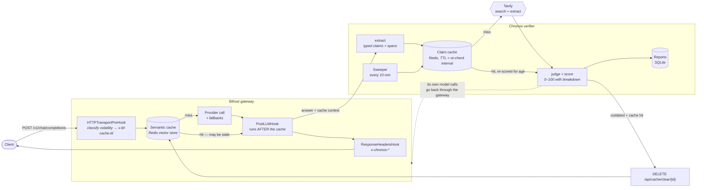

# Architecture

## The shape of it

The dotted line matters: the verifier's extraction and judging calls are made
*through* Bifrost with a dedicated virtual key, not direct to a provider. They
inherit the gateway's budgets, rate limits, fallbacks and logs, and Chronos
dogfoods the thing it extends.

## Where each decision lives

| Decision | Where | Why there |
|---|---|---|
| How long may this answer be cached? | `plugin/classify.go` | Depends only on the prompt, so it can be decided before the provider is called, with regex and no allocation. |
| Is this sentence worth checking? | `verifier/chronos/rules.py` | Needs the answer, and benefits from being swappable for a model. |
| Does the evidence support the claim? | `verifier/chronos/judge_rules.py` | The judgement, rule-based or model-based behind one interface. |
| What is this claim worth, 0–100? | `verifier/chronos/score.py` | Pure functions over evidence; the most-tested file in the repo. |
| Should this cache entry die? | `plugin/main.go` + `verifier/chronos/evictor.py` | The plugin knows a cache hit just happened; the verifier handles verdicts that land after the response went out. |
| What may this caller do? | `verifier/chronos/policies.py` | Keyed on the virtual key Bifrost already resolved. |

## The request path, twice

**A fresh answer** (cache miss). Classification costs microseconds. The answer
goes out, and verification happens in a background goroutine — the gateway adds
a spawn. The verdict reaches the response as `pending`, and the real result
arrives on the SSE stream and in the report store.

**A cached answer** (cache hit). No provider latency was spent, and this is the
only answer that can be stale, so it is verified *inline* within a deadline.
With a warm claim cache that costs about 28 ms and no Tavily credits. If a
claim is outdated, the entry is evicted before the next caller can be given it.

That asymmetry is the central performance decision: the expensive path stays
fast, and the risky path is the one that waits.

## Degradation

Chronos has no failure mode that fails a request.

| Failure | Behaviour |
|---|---|
| Verifier down or slow | Response passes through, verdict `unverifiable`, warning logged |
| Tavily budget spent | Degrades to observe mode; `degraded` and `reason` reported |
| Model unavailable | Falls back to rule-based extraction and judging |
| Redis unavailable | Claim cache falls back to a bounded in-process dict |
| Extraction returns nonsense | Retried once with the error, then the answer is `unverifiable` |
| Eviction returns an error | Logged; the answer is unaffected |
| Verification queue full | A background report is dropped rather than spawning goroutines |

## Data stores

| Store | Holds | Lifetime |
|---|---|---|
| Redis (`db 0`) | Bifrost's semantic cache | TTL Chronos sets per request |
| Redis (`db 1`) | Chronos's claim cache | TTL = the class's re-check interval |
| SQLite | Reports, policies, cache events | Durable |
| In-process | The verdict store between hooks | 60 s, bounded at 4096 |
| In-process | Tavily credit budget | Per day, reset on restart — a known limitation |

## Why the claim cache is the load-bearing component

Verifying a claim costs a Tavily search, an extract and a judge call. The same
claims recur constantly: every user asking what GPT-4o costs produces the same
claim about the same subject and predicate. Caching the **verdict**, keyed on
the normalised subject + predicate and *not* on the stated value, makes the
second and later answers free.

Not keying on the stated value is the subtle part. Two answers asserting
different prices for the same product are the same question — "what is this
product's price?" — and must share one verified answer. Including the stated
value would mean a *wrong* answer never hits the cache, which is exactly
backwards.

A cached verdict is re-scored rather than replayed: the evidence is reused but
the decay term `D` is recomputed against now, so a market claim verified 50
minutes ago under a 1-hour re-check interval scores lower than one verified a
minute ago. Replaying the stored score would reintroduce staleness one level
up — a stale staleness check.

Measured effect: inline verification on a cache hit went from 841 ms to 5.4 ms
p50, and credits from 90 to 55 per pass.
