# The console

One page, an opening stage and nine sections, no routing. It is an instrument panel rather
than a dashboard: everything on it is either a live reading or a recorded replay, and it says
which.

The page opens on a full screen of argument rather than in the middle of a dashboard, and
offers two ways in: a guided walkthrough, or scrolling. Both are described below.

The design is not mine to change. `design/chronos-console.html` is the reference the console
is built to match — tokens, type scale, layout and motion — and `console/src/instrument.css`
is lifted from it verbatim rather than reimplemented. When the two disagree, the reference is
right. [design/chronos-console.md](../design/chronos-console.md) is that reference as plain
text, which is the readable way to diff the copy.

## What it looks like

Captured from the console running **live** against the local stack on 8 Nov 2026, apart from
the briefing and the phone cycle, which are the recorded demo and say so in the header. The
same console is hosted with no backend at <https://chronos-sable-one.vercel.app/>.

| | |
|---|---|
|  |  |
| **The opening stage.** Live counters from `/v1/stats` over a rotating globe, and the two ways in. | **The walkthrough, step 4 of 9.** A card on the right that can be dragged out of the way; it scrolls the real page and rings the section being talked about. |
| 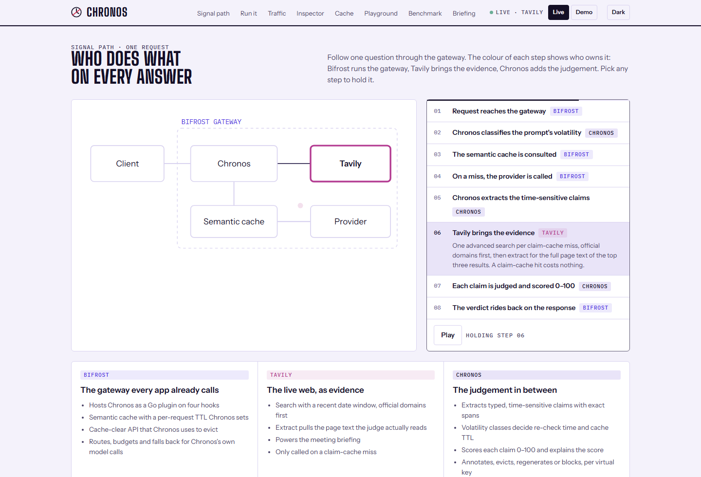 |  |
| **The signal path.** Eight steps through one request, coloured by who owns each — Bifrost, Tavily, Chronos. Pause holds a step. | **Dark mode.** The same instrument with the dark tokens from the design reference. |
| 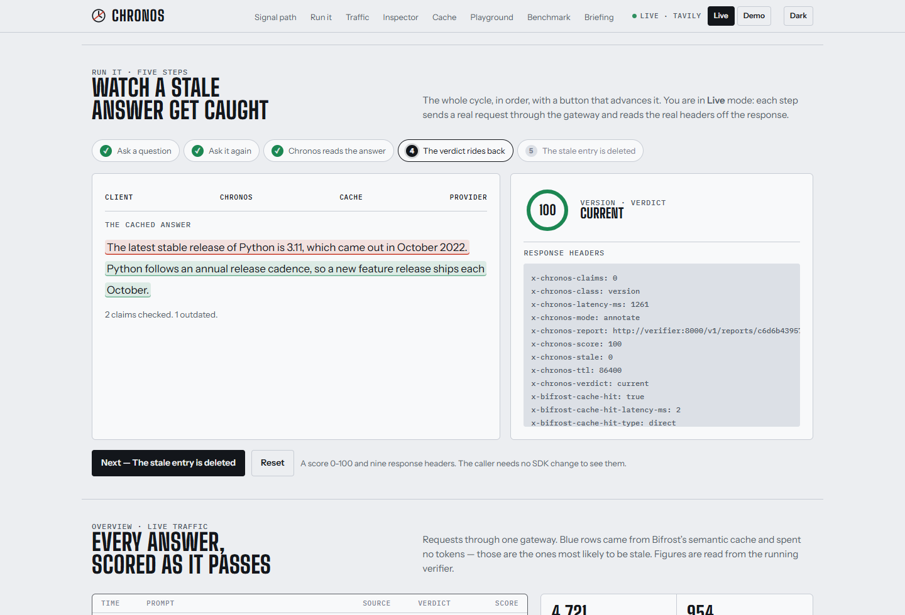 | 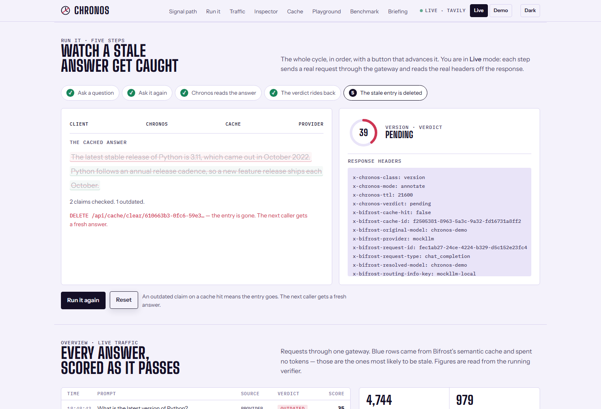 |
| **Run it, step four, live.** The verdict read off a real reply to a real cache hit. | **Run it, step five.** The stale entry deleted through the gateway's cache API. |
|  | 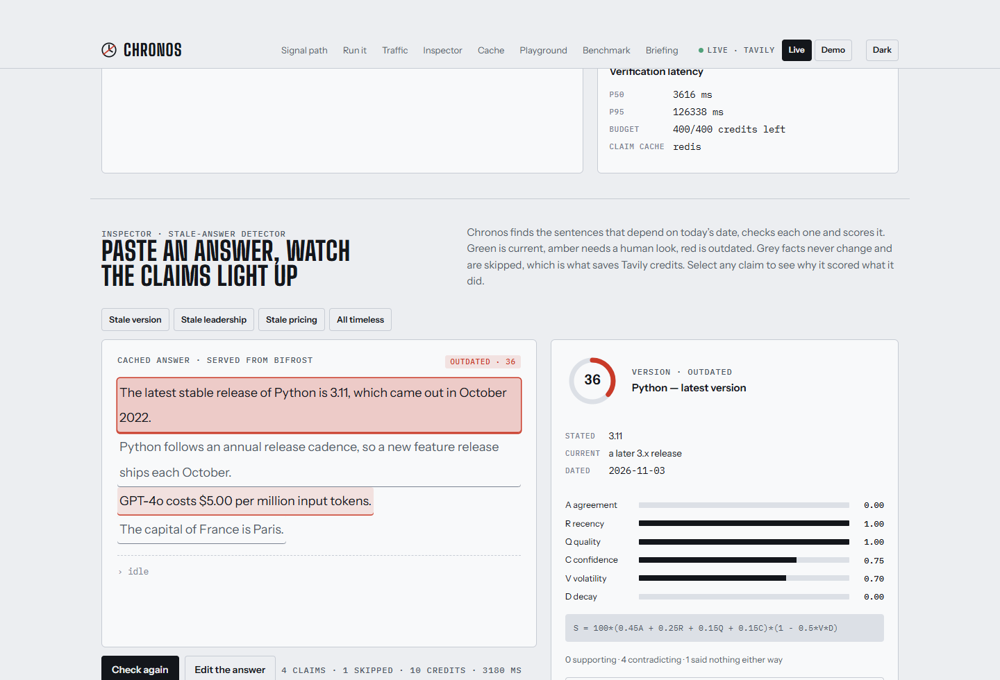 |
| **Traffic.** Every verification as it finishes, over SSE. Blue rows came from the cache. | **The inspector, before a check.** It opens on a recorded example and, in Live mode, says so. |
| 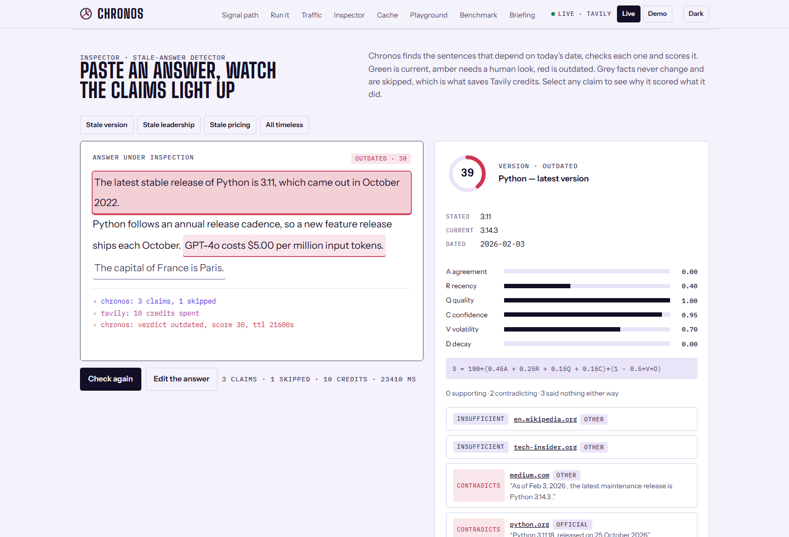 | 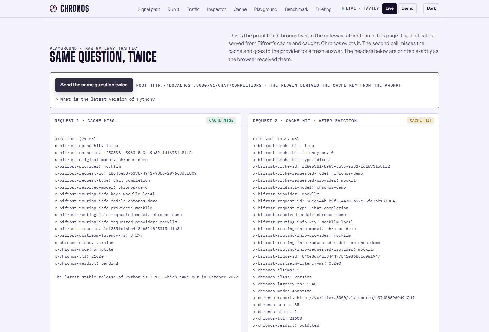 |
| **The inspector, after Check again.** The same answer verified live; the sources are today's pages. | **The playground.** Headers exactly as the browser received them. Each panel's label is read from those headers. |
| 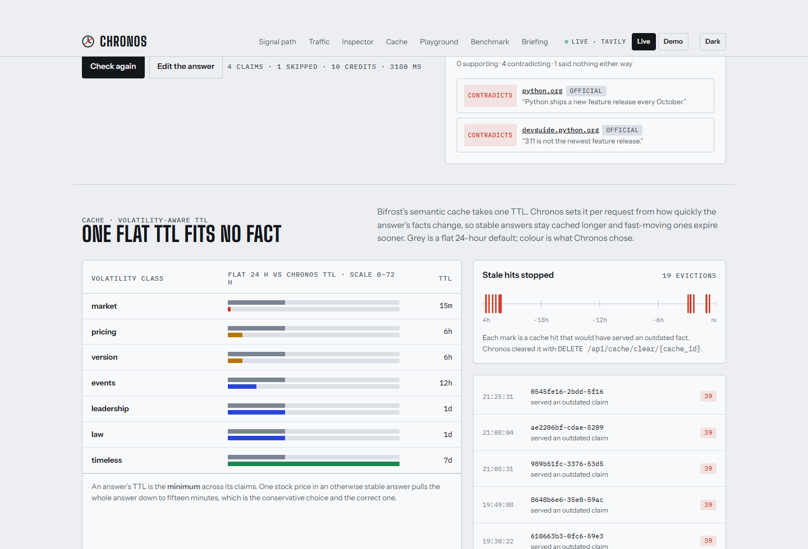 |  |
| **The cache.** What Chronos chose against a flat default, and every stale hit it stopped. | **The benchmark.** Read from `bench/results.json`; the rule engine's weak numbers included. |
| 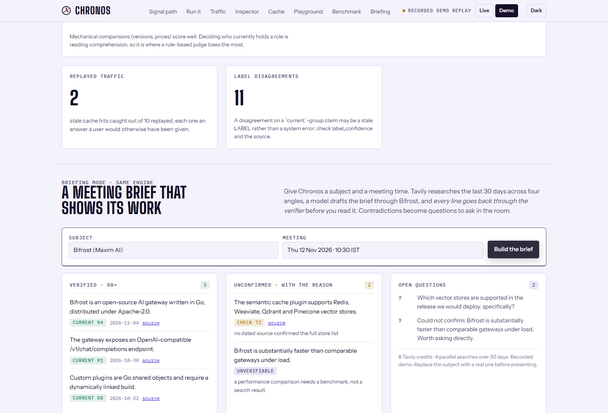 | 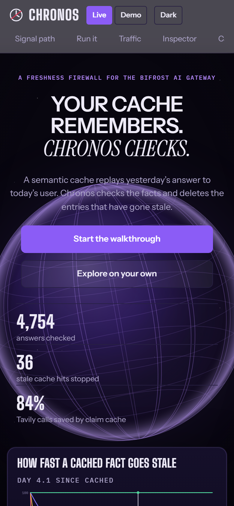 |
| **Briefing mode.** Contradictions become questions to ask in the room. | **A phone, 390 px.** The page never scrolls sideways at 360, 390, 430, 520, 640 or 768 px, measured. |
| 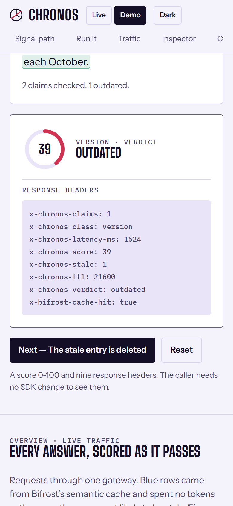 | 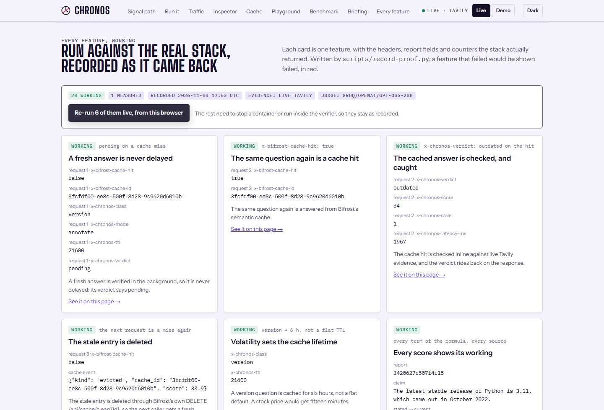 |
| **Run it on a phone.** The five steps stack into one column. | **Every feature, working.** Twenty features run against the live stack, with what came back; six re-run live from the browser. |

Every one of these is regenerated from the running console by
`node <readme-suite>/scripts/shots.mjs --file docs/screenshots/shots.json`, with the shot
list kept in the repo at `docs/screenshots/shots.json`. Every shot uses only the steps that
script understands — clicks and waits — so the command above is the whole recipe. They are
captures, not mock-ups. The live ones vary run to run, because the counters and the web do.

## The opening stage and the walkthrough

These two are the one place the console deliberately goes past
`design/chronos-console.html`, which was written before either existed. They use its tokens
and nothing else — no new colours, no new type — so the instrument panel below the fold is
unchanged, and `design.test.ts` still holds every token to the reference.

**The stage** is `console/src/sections/Hero.tsx`: one full-bleed, always-dark frame holding
the claim, the two ways in, the live counters, and a cropped sliver of the decay scope under
the fold. Under it an animated cue, which is the only thing telling a first-time viewer that
the page continues; it hides itself once `window.scrollY` passes 40, and during the
walkthrough. The sticky header goes dark with it and transitions back on scroll.

Dark is done by **re-pointing the palette tokens inside the section to the reference's own
dark values**, not by inventing colours — so everything nested in it, the scope panel and the
pills and the buttons, renders dark for free and stays consistent with the instrument panel
below. The glow behind the type is three soft blooms in Bifrost blue, Tavily magenta and the
`--bad` red, so even the background means something.

It moves, and each piece of movement is doing a job rather than decorating:

| | |
| :--- | :--- |
| The copy reveals in reading order | So the eye is led down to the two buttons instead of landing in the middle of a wall of type |
| The counters count up | They are real figures from `/v1/stats`, or the recorded log in demo mode. Watching them arrive says "running system" in a way a static number cannot |
| The decay scope sweeps a week | That curve **is** the argument — a fact's value falls off at a rate its class decides — so it is the one thing on the page that must not be a still image |

All three are off under `prefers-reduced-motion`: the copy appears, the counters show their
final values, and the scope holds at day three, which is the point the argument reads
clearest. Nothing is lost but the movement, and `Hero.test.tsx` holds it to that.

The count-up reads elapsed time from `performance.now()` rather than from the timestamp the
host hands `requestAnimationFrame`. The two are not guaranteed to share an origin — under
jsdom they do not — and when they disagree the count never reaches its target, leaving the
most prominent number on the page quietly wrong. That was a real failure, caught by the test
above being flaky rather than by looking at it.

**The walkthrough** (`console/src/sections/Walkthrough.tsx`) is ten steps in the order the
product happens: the problem, where Chronos sits, the cycle driven by hand, answers being
checked, the claims and the score, the TTL policy and the eviction ledger, the headers on the
response, the measured numbers, the briefing, and every feature run for real. Each step scrolls to a **real section and rings it** — there is
nothing in the tour that is not already on the page, which is deliberate: a tour that shows
something the product cannot do is a lie with a Next button. It is driveable with the arrow
keys and closes on Escape, and it respects `prefers-reduced-motion`.

It is a **card on the right, draggable by its grip**, and clamped so it cannot be dragged
off screen. It began as a bar across the foot of the page, which covered whatever step one
was pointing at — the thing a tour exists to show. Which part of the screen is clear depends
on the section, so the reader moves it.

The steps live in one exported array, so `Walkthrough.test.tsx` can assert that every one of
them points at a section id that exists. A typo in a target fails the suite by name rather
than producing a Next button that goes nowhere.

## Run it: the driveable demo

`#run` is the section a judge is meant to use. The rest of the console shows
*parts* of Chronos; this shows the **cycle**, in order, with a button that
advances it: ask a question, ask it again and get the cached answer, watch the
claims get pulled out and checked, read the verdict off the headers, watch the
entry be deleted.

In **live** mode each step issues a real request through the gateway and reads
the real `x-chronos-*` headers off the response. In **demo** mode the same five
steps replay a recorded exchange through the same rendering path.

**It never dead-ends.** If a live request fails — gateway down, CORS, an
offline laptop — the recorded exchange stands in, the panel says *"Recorded"*
and why, and the button still advances. That is the same rule the plugin
follows: a failure of ours must not stop the thing in front of the user.

The animation carries meaning rather than decorating: a packet travels the
signal path while a request is in flight, claims light one at a time as they are
checked, the score dial sweeps to its value, and the answer is struck through
when its cache entry is deleted. All of it is a plain state change under
`prefers-reduced-motion`.

## The opening scene

Three stacked layers, all `pointer-events: none`, over an always-dark frame:

| Layer | What it is |
| :--- | :--- |
| `::before` | The starfield. Eight dot sizes at eight densities so it does not read as a grid, breathing on a 7s cycle |
| `.globe` | A **rotating globe**: `console/src/sections/Globe.tsx` |
| `::after` | A vignette that sinks the edges, so it reads as a scene rather than a flat fill |

The globe is SVG and CSS transforms, not WebGL — the console already ships 222 kB of
JavaScript and a decorative background does not justify a 3D library on top of it.

The rotation is one idea. A meridian seen from outside a sphere projects to an ellipse whose
vertical axis is the sphere's radius and whose horizontal axis is `R·cos(angle)`. As the
globe turns, that horizontal axis sweeps `R → 0 → −R → 0 → R`: the meridian flattens to a
vertical line when it is edge-on and opens out again on the far side. So each meridian is an
ellipse animated on `scaleX` from 1 to −1, each started at its own offset. That is the whole
illusion, at one GPU-composited transform per meridian.

Parallels do not move: their horizontal axis is `√(R² − y²)` and their vertical axis is that
times the tilt, so they bunch toward the poles on their own.

`Globe.test.tsx` holds the parts that would break quietly: that it stays hidden from
assistive technology, that its parallels stay inside the rim, that they are flattened rather
than circular, and that **every meridian has a different animation offset** — collapse those
to one and the sphere pulses instead of turning, which looks like a bug and is one deleted
line away.

All of it holds still under `prefers-reduced-motion`.

### Responsive

Checked by rendering, twice, at four sizes rather than by reasoning about breakpoints:

| Width | What changes |
| :--- | :--- |
| 1536 and 1280 | The full scene; the chart and the scroll cue sit below the fold |
| 834 (tablet) | Sphere widens relative to the viewport; headline drops to `8vw`; the whole hero plus the chart fits one screen |
| 390 (phone) | Buttons stack full width, counters stack with rules between them, and the section nav becomes one horizontally scrolling row instead of wrapping to three and eating 170px before the page begins |

## Motion

None of it changes a colour: `design.test.ts` holds every `:root` token to
`design/chronos-console.html`, so depth and response come from movement rather than from a
bolder palette.

| | |
| :--- | :--- |
| Sections | Fade and rise as the reader reaches them, driven by an `IntersectionObserver` (`console/src/useReveal.ts`) rather than a scroll handler, so a long page costs no per-frame layout read |
| Nav links | An underline that grows from the left |
| Buttons | Lift on hover and cast a shadow in their own colour |
| Panels, chips, pills, counters | Lift or take an accent-coloured ring on hover |
| The walkthrough card | Slides in, carries a gradient edge in the product colours, and has a grab cursor on its grip |
| The live dot | Pulses, because it means something is connected |

Every one of them is disabled under `prefers-reduced-motion`, including the scroll reveal —
which is never applied in the first place there, so the page renders complete rather than
hidden and waiting.

## The sections

| Anchor | Section | What it reads | Source |
| :--- | :--- | :--- | :--- |
| `#path` | Signal path | nothing; it is an explanation | `console/src/App.tsx` |
| `#run` | Run it | nothing in demo mode; `POST /v1/chat/completions` through the gateway in live mode | `console/src/sections/RunIt.tsx` |
| `#traffic` | Traffic | `GET /v1/stream` over SSE, `GET /v1/stats` | `console/src/sections/Traffic.tsx` |
| `#inspect` | Inspector | `POST /v1/verify` on demand | `console/src/sections/Inspector.tsx` |
| `#cache` | Cache | `GET /v1/cache/events`, `GET /v1/stats` | `console/src/sections/Cache.tsx` |
| `#playground` | Playground | `POST /v1/chat/completions` through the gateway | `console/src/sections/Playground.tsx` |
| `#bench` | Benchmark | `public/results.json`, copied from `bench/results.json` | `console/src/sections/Benchmark.tsx` |
| `#brief` | Briefing | `POST /v1/brief` | `console/src/sections/Briefing.tsx` |
| `#proof` | Every feature | `public/proof.json`, written by `scripts/record-proof.py`; in Live mode, six checks re-run from the browser | `console/src/sections/Proof.tsx`, `console/src/proof.ts` |

`console/src/useChronos.ts` owns the mode, the feed, the counters and the connection. Every
section is a reader; none of them fetches on its own except on a click.

## Live and demo

The switch in the header picks between two sources of everything on the page.

- **Live** opens the SSE stream and shows real verifications. The dot beside it is green when
  the stream is open and red when it is not.
- **Demo** replays `console/src/demo.ts`, a recorded log, and labels itself: *"Demo mode.
  Traffic on this page is a recorded replay."* Nothing in demo mode is presented as live.

**Demo is the default**, and it is the default on purpose: judging and screenshots have to
work with no stack running and no keys. The console falls back to it whenever the verifier
cannot be reached, rather than showing an empty page or an error.

## Colour means ownership

Three product colours, used for nothing else. If a box is blue, Bifrost owns that step.

| Token | Light | Dark | Means |
| :--- | :--- | :--- | :--- |
| `--brand` | `#6D3BF5` | `#8B5CF6` | The violet the opening is built on. A **brand** colour, never an ownership one |
| `--brand-2` | `#9B6BFF` | `#B78BFF` | Its lighter partner: hover, the rim light, the eyebrow |
| `--bifrost` | `#4F32E0` | `#8B7BFF` | Bifrost owns it |
| `--tavily` | `#B43C92` | `#E980CF` | Tavily owns it |
| `--chronos` | `#140F26` | `#EEEBF8` | Chronos owns it |
| `--ok` | `#17855A` | `#4FD39A` | `current` |
| `--warn` | `#B07400` | `#F0B747` | `check` |
| `--bad` | `#CE3552` | `#FF6B8A` | `outdated` |
| `--paper` / `--panel` | `#F4F2FB` / `#FFFFFF` | `#08060F` / `#110D20` | Ground, and panels on it |

The palette moved to violet deliberately, and **the reference moved with it** —
`design/chronos-console.html` and `instrument.css` were rewritten in the same commit, so
`design.test.ts` still holds them to each other token for token. The three ownership colours
shifted hue but kept their jobs; the test pins their new values so the next change is
deliberate too, and asserts that `--brand` is distinct from `--bifrost` because a brand
colour must never be read as "Bifrost owns this".

Dark mode follows `prefers-color-scheme` and is overridable with the header toggle, which
sets `data-theme` on `:root`. Both are in the reference and both are in
`console/src/instrument.css`.

Type: `Big Shoulders Display` for section headings, `Instrument Sans` for body and for the
opening headline, **`Instrument Serif` italic for the headline's second line** — which is
what turns a slogan into a sentence someone wrote — and `IBM Plex Mono` for anything that is
a value — ids, headers, scores, formulas. All three from Google Fonts, with
system fallbacks named so the layout holds if the fonts do not load.

## The mark

Two drawings of one idea, and the reason is small sizes.

The header mark is the reference's: a dial with an hour hand, struck through in `--bad`
(`design/chronos-console.html`, line 249). At 22 px beside the word *Chronos* it reads
cleanly, and the slash is the point of the product rather than decoration.

Below about 32 px the slash crosses both the hands and the ring and the whole mark fills in.
So the favicon and the app tile are a redraw of the same idea — a dial with the last quarter
filled in `--bad` — which survives 16 px. The source is `design/icon.svg`;
`console/public/favicon.svg` is a copy of it, and `console/public/icon-512.png` and
`docs/icon.png` are rendered from it.

## How it is checked

**125 tests**, in eleven files, run by `npm test` in `console/` and by
`scripts/verify-all.sh`.

| File | Covers |
| :--- | :--- |
| `console/src/api.test.ts` | The data layer's quiet failures: a malformed SSE frame must not take the feed down, a 422 must carry the verifier's reason, and `chatThroughGateway` must keep the gateway's own headers and drop everything else |
| `console/src/useChronos.test.ts` | Mode selection, the SSE lifecycle, the counters, and that a manual mode choice survives a probe that answers late |
| `console/src/App.test.tsx` | That every section the nav points at renders, that no nav link points nowhere, that each claim is a selectable button with its subject and score in its label, that every term of the formula is shown, that a timeless claim is grey rather than green, and that the theme toggle works |
| `console/src/sections/Globe.test.tsx` | The rotating globe: that it is hidden from assistive technology, that its parallels stay inside the sphere and are flattened, and that its meridians are staggered rather than sharing one offset |
| `console/src/sections/RunIt.test.tsx` | The driveable demo: that every stage is listed and marked as it advances, that demo mode sends no request at all, that the last step reaches a verdict and an eviction, and — the one that matters — that a failed live request falls back to the recorded exchange and says so rather than leaving a button that does nothing |
| `console/src/sections/Hero.test.tsx` | The stage: what it says, that the counters count up and land on the real figures without overshooting, that motion is skipped under `prefers-reduced-motion`, and that the decay scope draws and reads off one curve per volatility class |
| `console/src/sections/Walkthrough.test.tsx` | The opening stage and the tour: that every step points at a section that exists, that exactly one is ringed at a time, that nothing stays lit when it closes, that the last step finishes rather than running off the end, and that the arrow keys and Escape work |
| `console/src/design.test.ts` | Fidelity against `design/chronos-console.html`: every `:root` token defined, with the same value, both dark-mode blocks present, every font stack ending in a generic family, and the seven sections in the reference's order |

Writing these found one real bug, which is the argument for having them.
`useChronos` decided whether to switch the console from demo to live by reading
a `modeLocked` flag held in state, from inside an async callback — so it read
the value captured on the *first* render, which is always `false`. The lock was
a no-op, and a probe that answered late overruled a mode the operator had
already picked. The comment above it described the behaviour it was supposed to
have rather than the behaviour it had. It is a `useRef` now, and
`console/src/useChronos.test.ts` holds it there.

The fidelity test is the one worth explaining. It is not a pixel diff — it
compares the values that are literally the same text in two files, which is the
part that drifts without anyone noticing. Changing `--bifrost` in
`instrument.css` alone fails it by name.

Alongside the suite, four checks in `scripts/verify-all.sh` prove the deployed
thing works: that nginx serves the shell, that the built bundle is referenced,
that `public/results.json` is served, and that the gateway publishes the nine
`x-chronos-*` headers on `Access-Control-Expose-Headers` — without which the
console would show blanks in a browser while `curl` looked fine.

**What is still not checked:** nothing renders in a real browser engine. jsdom
reports what the components produce, not what a browser paints, so a CSS
mistake — a panel that overflows, a colour with no contrast — would pass every
one of these. The screenshots above are the only evidence of that, and they are
looked at by a person.

## Changing it

```bash
cd console
npm install
npm run dev        # Vite on :5173, talking to the stack's :8000 and :8080
npm run typecheck
npm run build
```

`VITE_VERIFIER_URL` and `VITE_BIFROST_URL` are compiled in, so changing either needs
`docker compose build console` rather than a restart. See
[environment.md](environment.md).
