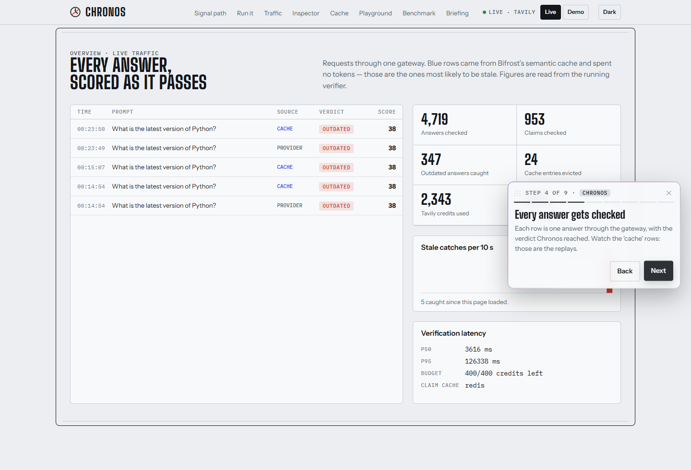

# The console

One page, an opening stage and seven sections, no routing. It is an instrument panel rather
than a dashboard: everything on it is either a live reading or a recorded replay, and it says
which.

The page opens on a full screen of argument rather than in the middle of a dashboard, and
offers two ways in: a guided walkthrough, or scrolling. Both are described below.

The design is not mine to change. `design/chronos-console.html` is the reference the console
is built to match — tokens, type scale, layout and motion — and `console/src/instrument.css`
is lifted from it verbatim rather than reimplemented. When the two disagree, the reference is
right. [design/chronos-console.md](../design/chronos-console.md) is that reference as plain
text, which is the readable way to diff the copy.

## What it looks like

| | |
|---|---|
|  |  |
| **The hero.** Live counters from `/v1/stats`, and the decay curves that explain why one TTL cannot fit every fact. | **The inspector.** The signature mechanism, visible: claims lit up inside the answer, the score with every term of the formula, and the pages that disagreed, quoted. |
|  |  |
| **The cache.** What Chronos chose against a flat default, and a ledger of real evictions with their cache ids. | **The signal path, in dark mode.** Eight steps through one request, colour-coded by who owns each — Bifrost, Tavily, Chronos. |
|  |  |
| **Traffic.** Every verification as it finishes, over SSE. | **Playground and benchmark.** A real recorded exchange with its headers, then the numbers read straight from `bench/results.json`. |
|  | |
| **The walkthrough, step 4.** Eight steps that scroll the real page and ring the section being talked about. | |

Every one of these is regenerated from the running console by
`node <readme-suite>/scripts/shots.mjs --file docs/screenshots/shots.json`, with the shot
list kept in the repo at `docs/screenshots/shots.json`. They are captures, not mock-ups.

## The opening stage and the walkthrough

These two are the one place the console deliberately goes past
`design/chronos-console.html`, which was written before either existed. They use its tokens
and nothing else — no new colours, no new type — so the instrument panel below the fold is
unchanged, and `design.test.ts` still holds every token to the reference.

**The stage** is the existing hero at `min-height: calc(100svh - 72px)`, so the first thing a
viewer sees is the claim and the decay chart rather than half a traffic feed. `min-height`,
not `height`: it grows rather than clipping when the header wraps. Under it sit two calls to
action and an animated scroll cue, which is the only thing telling a first-time viewer that
the page continues; the cue hides itself once `window.scrollY` passes 40, and during the
walkthrough.

**The walkthrough** (`console/src/sections/Walkthrough.tsx`) is eight steps in the order the
product happens: the problem, where Chronos sits, answers being checked, the claims and the
score, the TTL policy and the eviction ledger, the headers on the response, the measured
numbers, the briefing. Each step scrolls to a **real section and rings it** — there is
nothing in the tour that is not already on the page, which is deliberate: a tour that shows
something the product cannot do is a lie with a Next button. It is driveable with the arrow
keys and closes on Escape, and it respects `prefers-reduced-motion`.

The steps live in one exported array, so `Walkthrough.test.tsx` can assert that every one of
them points at a section id that exists. A typo in a target fails the suite by name rather
than producing a Next button that goes nowhere.

## The sections

| Anchor | Section | What it reads | Source |
| :--- | :--- | :--- | :--- |
| `#path` | Signal path | nothing; it is an explanation | `console/src/App.tsx` |
| `#traffic` | Traffic | `GET /v1/stream` over SSE, `GET /v1/stats` | `console/src/sections/Traffic.tsx` |
| `#inspect` | Inspector | `POST /v1/verify` on demand | `console/src/sections/Inspector.tsx` |
| `#cache` | Cache | `GET /v1/cache/events`, `GET /v1/stats` | `console/src/sections/Cache.tsx` |
| `#playground` | Playground | `POST /v1/chat/completions` through the gateway | `console/src/sections/Playground.tsx` |
| `#bench` | Benchmark | `public/results.json`, copied from `bench/results.json` | `console/src/sections/Benchmark.tsx` |
| `#brief` | Briefing | `POST /v1/brief` | `console/src/sections/Briefing.tsx` |

`console/src/useChronos.ts` owns the mode, the feed, the counters and the connection. Every
section is a reader; none of them fetches on its own except on a click.

## Live and demo

The switch in the header picks between two sources of everything on the page.

- **Live** opens the SSE stream and shows real verifications. The dot beside it is green when
  the stream is open and red when it is not.
- **Demo** replays `console/src/demo.ts`, a recorded log, and labels itself: *"Demo mode.
  Traffic on this page is a recorded replay."* Nothing in demo mode is presented as live.

**Demo is the default**, and it is the default on purpose: judging and screenshots have to
work with no stack running and no keys. The console falls back to it whenever the verifier
cannot be reached, rather than showing an empty page or an error.

## Colour means ownership

Three product colours, used for nothing else. If a box is blue, Bifrost owns that step.

| Token | Light | Dark | Means |
| :--- | :--- | :--- | :--- |
| `--bifrost` | `#2744E0` | `#7088FF` | Bifrost owns it |
| `--tavily` | `#A23F86` | `#E27CC5` | Tavily owns it |
| `--chronos` | `#13161B` | `#E6E9EE` | Chronos owns it |
| `--ok` | `#1C8752` | `#4CC38A` | `current` |
| `--warn` | `#B57600` | `#E5AE3B` | `check` |
| `--bad` | `#C93A28` | `#F06B56` | `outdated` |
| `--paper` / `--panel` | `#ECEEF1` / `#F8F9FA` | `#0E1115` / `#151920` | Ground, and panels on it |

Dark mode follows `prefers-color-scheme` and is overridable with the header toggle, which
sets `data-theme` on `:root`. Both are in the reference and both are in
`console/src/instrument.css`.

Type: `Big Shoulders Display` for headings, `Instrument Sans` for body, `IBM Plex Mono` for
anything that is a value — ids, headers, scores, formulas. All three from Google Fonts, with
system fallbacks named so the layout holds if the fonts do not load.

## The mark

Two drawings of one idea, and the reason is small sizes.

The header mark is the reference's: a dial with an hour hand, struck through in `--bad`
(`design/chronos-console.html`, line 249). At 22 px beside the word *Chronos* it reads
cleanly, and the slash is the point of the product rather than decoration.

Below about 32 px the slash crosses both the hands and the ring and the whole mark fills in.
So the favicon and the app tile are a redraw of the same idea — a dial with the last quarter
filled in `--bad` — which survives 16 px. The source is `design/icon.svg`;
`console/public/favicon.svg` is a copy of it, and `console/public/icon-512.png` and
`docs/icon.png` are rendered from it.

## How it is checked

**73 tests**, in five files, run by `npm test` in `console/` and by
`scripts/verify-all.sh`.

| File | Covers |
| :--- | :--- |
| `console/src/api.test.ts` | The data layer's quiet failures: a malformed SSE frame must not take the feed down, a 422 must carry the verifier's reason, and `chatThroughGateway` must keep the gateway's own headers and drop everything else |
| `console/src/useChronos.test.ts` | Mode selection, the SSE lifecycle, the counters, and that a manual mode choice survives a probe that answers late |
| `console/src/App.test.tsx` | That every section the nav points at renders, that no nav link points nowhere, that each claim is a selectable button with its subject and score in its label, that every term of the formula is shown, that a timeless claim is grey rather than green, and that the theme toggle works |
| `console/src/sections/Walkthrough.test.tsx` | The opening stage and the tour: that every step points at a section that exists, that exactly one is ringed at a time, that nothing stays lit when it closes, that the last step finishes rather than running off the end, and that the arrow keys and Escape work |
| `console/src/design.test.ts` | Fidelity against `design/chronos-console.html`: every `:root` token defined, with the same value, both dark-mode blocks present, every font stack ending in a generic family, and the seven sections in the reference's order |

Writing these found one real bug, which is the argument for having them.
`useChronos` decided whether to switch the console from demo to live by reading
a `modeLocked` flag held in state, from inside an async callback — so it read
the value captured on the *first* render, which is always `false`. The lock was
a no-op, and a probe that answered late overruled a mode the operator had
already picked. The comment above it described the behaviour it was supposed to
have rather than the behaviour it had. It is a `useRef` now, and
`console/src/useChronos.test.ts` holds it there.

The fidelity test is the one worth explaining. It is not a pixel diff — it
compares the values that are literally the same text in two files, which is the
part that drifts without anyone noticing. Changing `--bifrost` in
`instrument.css` alone fails it by name.

Alongside the suite, four checks in `scripts/verify-all.sh` prove the deployed
thing works: that nginx serves the shell, that the built bundle is referenced,
that `public/results.json` is served, and that the gateway publishes the nine
`x-chronos-*` headers on `Access-Control-Expose-Headers` — without which the
console would show blanks in a browser while `curl` looked fine.

**What is still not checked:** nothing renders in a real browser engine. jsdom
reports what the components produce, not what a browser paints, so a CSS
mistake — a panel that overflows, a colour with no contrast — would pass every
one of these. The screenshots above are the only evidence of that, and they are
looked at by a person.

## Changing it

```bash
cd console
npm install
npm run dev        # Vite on :5173, talking to the stack's :8000 and :8080
npm run typecheck
npm run build
```

`VITE_VERIFIER_URL` and `VITE_BIFROST_URL` are compiled in, so changing either needs
`docker compose build console` rather than a restart. See
[environment.md](environment.md).
